# Trading Lab — Design baseline (v0.1)

**Status: design proposal, not an authorization to run unattended.**
**Target: reproducible, autonomous *research* and controlled IBKR `DU…` paper execution.** No live-money trading in scope.
**Review policy:** any change to order submission, broker recovery, risk, or AI code execution must have an approved design, tests and operational rollback before implementation.

## 1. System boundaries

```mermaid
flowchart LR
  Market[Point-in-time market data] --> Ingest[Ingestion + immutable data manifests]
  Ingest --> Replay[Deterministic backtest / training]
  Ingest --> Snap[Trading-session snapshot builder]
  Ideas[LLM researcher in isolated worker] --> Sandbox[Code and behavior validation]
  Sandbox --> Replay
  Replay --> Registry[Immutable strategy registry + human approval]
  Registry --> Snap
  Snap --> Port[Portfolio optimizer and constraints]
  Port --> Risk[Independent pre-trade risk authorization]
  Risk --> Outbox[Durable order outbox and order state machine]
  Outbox --> Broker[IBKR paper adapter]
  Broker --> Inbox[Broker execution-event inbox]
  Inbox --> Ledger[Transactional positions / cash / fees ledger]
  Ledger --> Reconcile[Broker reconciliation]
  Reconcile --> Risk
  Observe[Health + operator controls] --> Risk
  Observe --> Outbox
```

There are **two isolated planes**:
1. Research plane: untrusted or experimental strategy generation, replay, analysis, immutable results. **No access to broker credentials or order-sending APIs**.
2. Paper-execution plane: only pinned, reviewed, approved strategy artifacts with deterministic inputs; broker identity, risk and order submission independently controlled.

## 2. Non-negotiable invariants

| ID | Invariant | Failure behavior |
| --- | --- | --- |
| INV-01 | Real-money accounts are never accepted; exactly the configured paper account must be verified from the broker | Fail closed, no orders |
| INV-02 | Every decision uses one complete, immutable exchange-session snapshot and an exact pinned universe | Skip session; alert |
| INV-03 | No order is created without a committed risk authorization for exactly that decision and the latest ledger state | Reject |
| INV-04 | Any unresolved submit, cancel, fill or restart ambiguity blocks **new** orders until authoritative broker reconciliation | Freeze and escalate |
| INV-05 | A fill changes balances and inventory **exactly once**; adjustments and partial fills are separately auditable | Reject / quarantine duplicate or unknown event |
| INV-06 | Drawdown/capital/rate limits and daily counters survive restarts and redeploys | Halt on missing/conflicting persistence |
| INV-07 | Order intents, broker events, cash movements, config changes and control actions form an append-only auditable history | Halt on storage errors |
| INV-08 | Emergency halt works without a new price bar, strategy output or complete daily snapshot | Block submissions, initiate verified cancel sequence |
| INV-09 | No AI-generated code is executable in the broker-connected runtime without immutable approval and sandboxed evaluation | Deny promotion |
| INV-10 | Historical conclusions can be reconstructed from exact data, code, settings, universe and costs; no future information is admitted | Reject run as invalid |
| INV-11 | Exactly one authorized process owns a given broker-account+strategy execution namespace | Halt second process |
| INV-12 | A passing build, recent heartbeat or broker socket does not alone constitute trading readiness | Separate liveness/readiness checks |
| INV-13 | The system cannot silently broaden from paper to live-money deployment | Code, config and deploy policy fail closed |
| INV-14 | A deployed version can be rolled back **without deleting, resetting or replaying** unknown orders/fills | Freeze, reconcile, then resume |

**Cash/position truth:** IBKR is authoritative for account observations; the internal ledger is authoritative for the application's own submitted intents and processed events. Disagreement is an incident, **not** an invitation to overwrite either side.

## 3. What exists vs what does not

Current agents are `SignalAgent` / `CrossSectionalAgent` → `AllocatorAgent` → `RiskAgent` → `ExecutionAgent`, with paper brokerage via NautilusTrader and a separate AI hypothesis pipeline. Existing checks include paper-account restrictions, on-disk JSON checkpoints, risk halt, partial-fill tracking, research holdout guard, and CI.

This is not yet a transactional, exactly-once execution platform. In particular:
- `allocator.py` publishes on **every individual signal**, not on a fully assembled session.
- `execution.py` relies on broker-cache comparisons and assumes an equity/approval message will be processed in time; there is no broker-history reconciliation handshake.
- `execution_state.py` JSON tracks intents and processed fill IDs, but is not an append-only transactional journal; account/universe identity is not encoded in the checkpoint.
- `cross_sectional.py` treats bars as recent when <4 days old; that is not equivalent to an exchange-session-valid bar.
- Risk drawdown observation is tied to equity snapshots at rebalance; no independent continuously operating broker-equity monitor.
- The kill-file `flatten` mode is subject to the rebalance's data and reconciliation gates. It does **not** guarantee independent emergency flattening.
- Research strategy files are dynamically imported into Python after AST checks; that does not constitute OS isolation.
- Backtests, historical data adjustments, memberships and execution assumptions require additional evidence and bias testing.

These are **open blockers**, not implemented features.

## 4. Single path from idea to authorization

1. Research hypothesis receives an immutable experiment ID and documented prior rationale.
2. Dataset, point-in-time universe, code revision, cost model and evaluation plan are sealed **before** computing candidate metrics.
3. Training + walk-forward + null + untouched final test are run with a logged trial budget; reject leakage or incomplete market history.
4. Human approves a particular cryptographic strategy/artifact hash and paper-only sizing limits.
5. Release pipeline signs/seals the manifest; deployments use an allowlist of approved strategy hashes.
6. Broker gateway authenticates the configured DU account. The runtime starts in `RECOVERING`, with submissions disabled.
7. It imports and reconciles broker cash, all positions and open/executed orders against the durable ledger; only then transitions to `READY`.
8. On each session, verified data complete → deterministic signals → one portfolio decision → risk permit → committed order outbox → broker.
9. Fills, cancels, fees, position changes and risk status are journaled; health and alerts expose both liveness and readiness.
10. Any break in a gate returns to a non-trading state. Operator recovery is explicit and audited.

## 5. Design change discipline

For each subsystem, produce **one contract and one implementation PR** with:
- scope, assumptions and non-goals;
- inputs, outputs, state transitions, invariants and persistence schema;
- failure-injection plan (crash before/after every external effect);
- threat model and rollback/migration policy;
- unit, property, replay, integration and operator-acceptance tests;
- observability (metrics, alerts, audit events);
- measurable exit criteria and evidence links.

Do not bundle unrelated broker, strategy, research and infrastructure changes into the same unreviewed release. Read [data-and-decision-contracts.md](data-and-decision-contracts.md), [execution-recovery.md](execution-recovery.md), [research-integrity.md](research-integrity.md), [deployment-operations.md](deployment-operations.md), [verification-and-roadmap.md](verification-and-roadmap.md) and [decisions.md](decisions.md).
